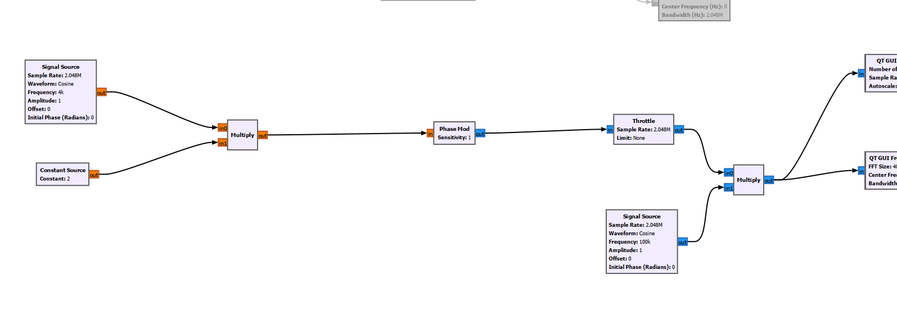
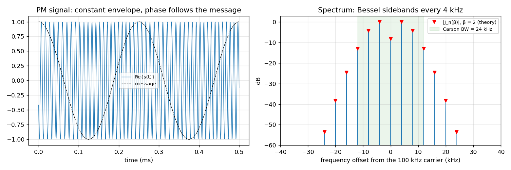
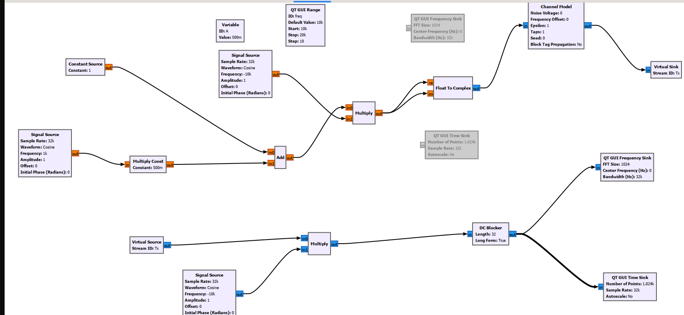
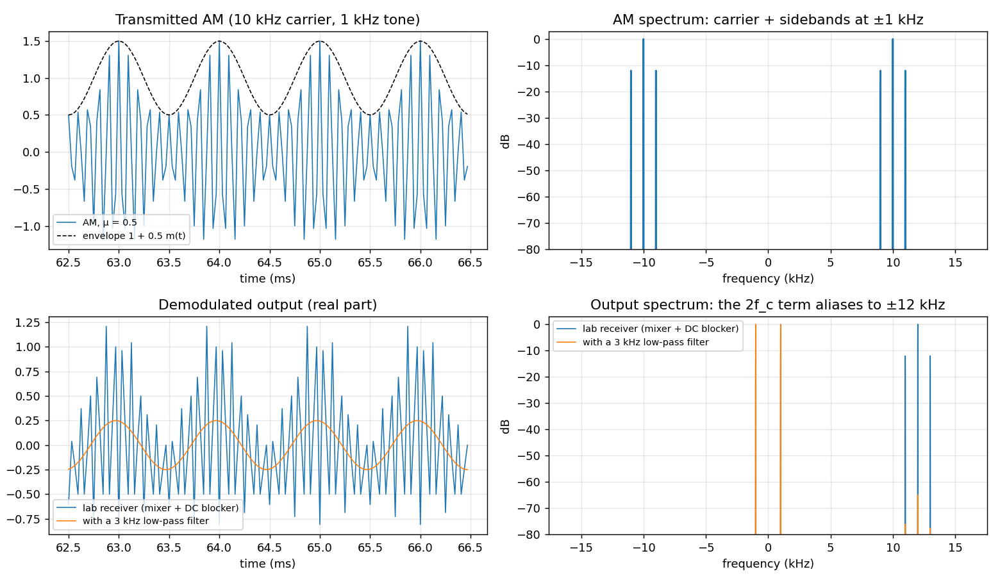
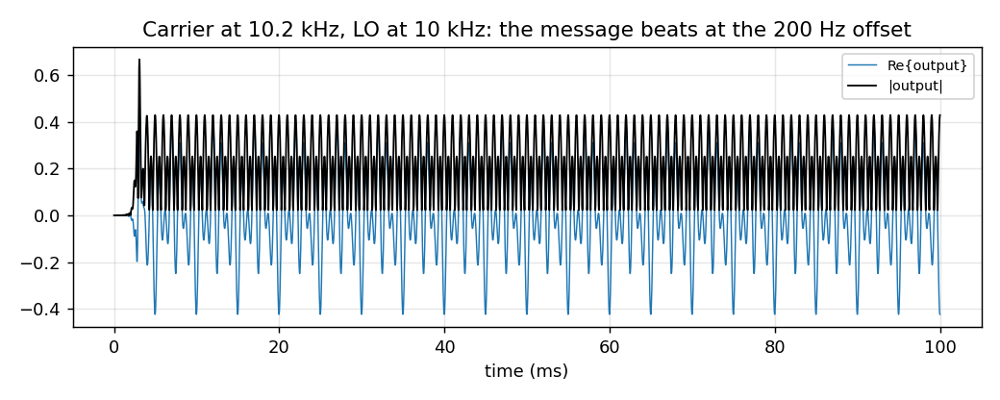
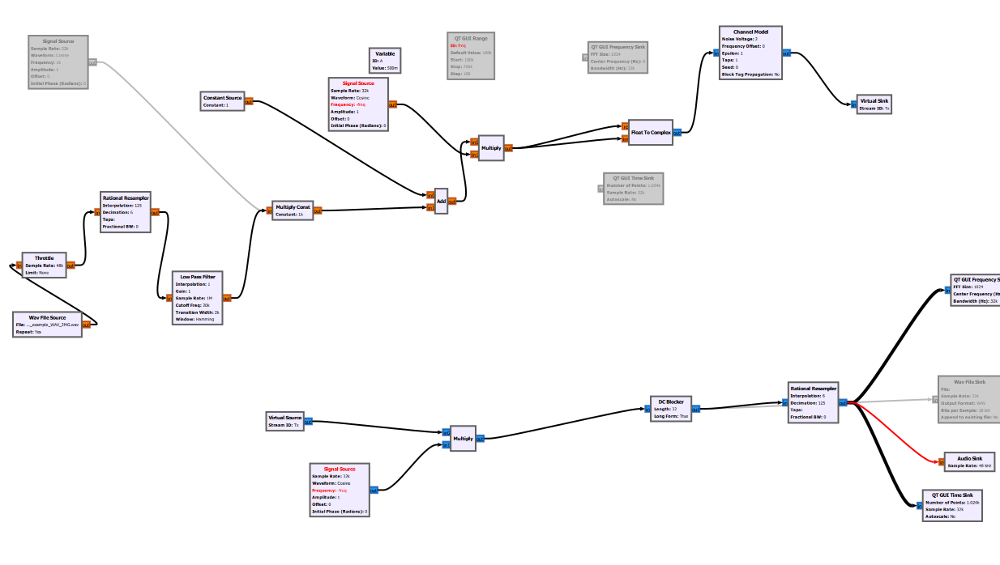
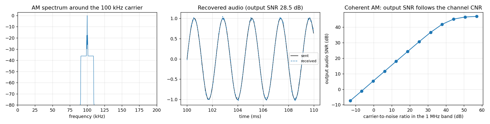

# Analog Modulation with GNU Radio: PM, AM and Audio over AM (Digital Communications Lab, Experiment 3)

This experiment built three software-defined-radio flowgraphs in **GNU Radio Companion**:
1. **Phase modulation** of a tone onto a 100 kHz carrier.
2. **AM** with a homodyne (mixer) receiver.
3. A complete **audio link**: a WAV file is sent over AM through a noisy channel and played back.

> **Course:** Digital Communications Lab, Amirkabir University of Technology, Spring 2026.
>
> **About this repository.** The lab submission contained only the report with flowgraph screenshots ([`flowgraphs/`](flowgraphs)); the `.grc` files were not kept. [`analog_modulation.py`](analog_modulation.py) is a **reconstruction in NumPy**: every GNU Radio block (Signal Source, Phase Mod, Channel Model, DC Blocker, Rational Resampler and so on) is mirrored by a small function using the parameters shown in the screenshots. It therefore runs without GNU Radio, and its results can be checked against theory.

```bash
pip install numpy scipy matplotlib
python analog_modulation.py        # -> results/*.png and results/fg3_*.wav
```

## 1. Phase modulation (2.048 MS/s)
**Flowgraph:** a 4 kHz cosine × constant 2 → `Phase Mod` (sensitivity 1) → × 100 kHz complex carrier, giving $s(t)=e^{j[2\pi f_ct + \beta\cos 2\pi f_mt]}$ with **β = 2 rad**.



**Results:**
- The envelope stays constant, and only the phase carries the message.
- By the Jacobi–Anger expansion, the spectrum is a set of lines every f_m = 4 kHz, with amplitudes $|J_n(\beta)|$. The simulated spectrum lands exactly on the Bessel values.
- **Carson's rule**, $B \approx 2(\beta+1)f_m = 24$ kHz, holds 99.8 % of the power (sidebands up to ±3).



## 2. AM with a homodyne receiver (32 kS/s)
**Transmitter:** a 1 kHz tone × 0.5 + 1 (a DC offset, so the envelope stays positive, with μ = 0.5) × a 10 kHz carrier.

**Receiver:** the signal is mixed with a −10 kHz complex local oscillator to bring it to baseband, and a `DC Blocker` removes the carrier term.





**Findings from the reconstruction:**
- **No low-pass filter after the mixer.** Mixing a real AM signal also produces a term at −2f_c = −20 kHz, which aliases to **±12 kHz** at 32 kS/s. The lab receiver's output therefore still contained a strong 12 kHz component on top of the message. A 3 kHz low-pass filter before the DC blocker gives a clean 1 kHz tone.
- **LO mismatch.** The GUI slider moved the transmit carrier (10–20 kHz), but the receiver LO stayed at 10 kHz. Any mismatch Δf shifts the output by Δf. In the example below, the message beats at 200 Hz. A homodyne receiver needs carrier recovery (a PLL); an envelope detector is the robust alternative for AM.



## 3. Audio over AM through a noisy channel
**Chain:** WAV (48 kS/s) → `Rational Resampler` 125/6 → 1 MS/s → 20 kHz low-pass → μ = 0.5, + 1 → × 100 kHz carrier → AWGN channel → coherent product detector → resample 6/125 → DC removal → audio sink and WAV file.



The test signal is synthetic (a short melody plus a 0.2–9 kHz chirp), so no third-party audio is involved. The transmitted and received audio are saved as [`results/fg3_tx_audio.wav`](results/fg3_tx_audio.wav) and [`results/fg3_rx_audio.wav`](results/fg3_rx_audio.wav).



**Results:**
- **Spectrum.** The AM signal occupies 100 kHz ± 20 kHz (DSB plus carrier).
- **SNR.** With coherent detection, the output audio SNR grows dB-for-dB with the channel's carrier-to-noise ratio: 28.5 dB at noise voltage 0.05. It levels off near 47 dB, the numerical floor of the resampling filters.
- **Where to remove DC.** A DC blocker is a high-pass filter whose corner scales with sample rate ÷ length. With 32 taps at 1 MS/s, the corner is near 15 kHz and would remove most of the audio band. So DC removal belongs **after** decimation to 48 kS/s, with a longer blocker; the reconstruction does it that way.

## Skills
GNU Radio / software-defined radio · analog modulation theory (PM, AM, Bessel spectra, Carson's rule) · receiver design (mixing, filtering, DC removal, resampling) · Python, NumPy and SciPy DSP

## Author
**Sepehr Ebrahimi**, B.Sc. Electrical Engineering, Amirkabir University of Technology (2026)
